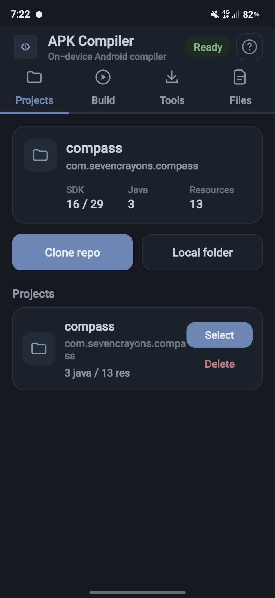
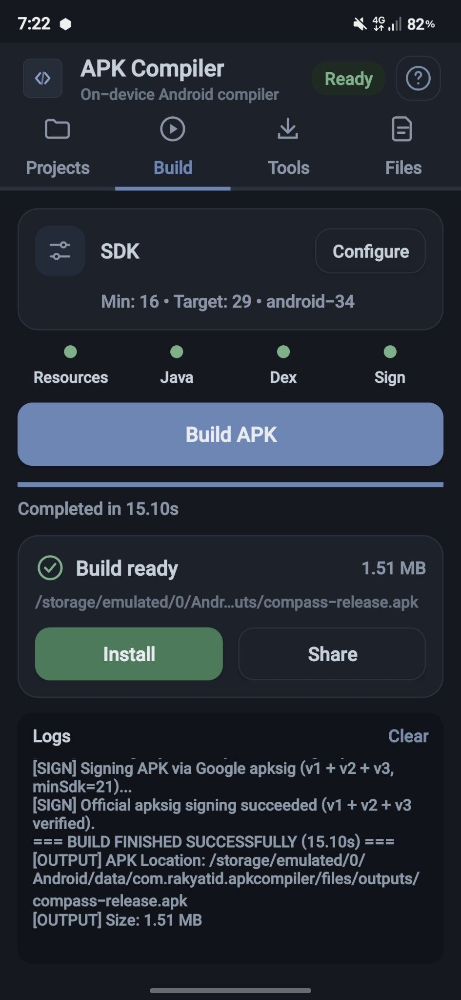
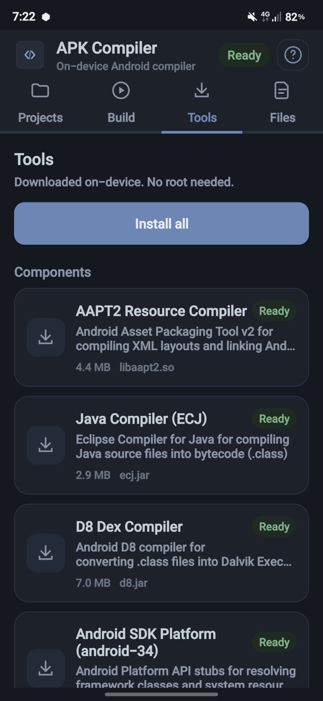
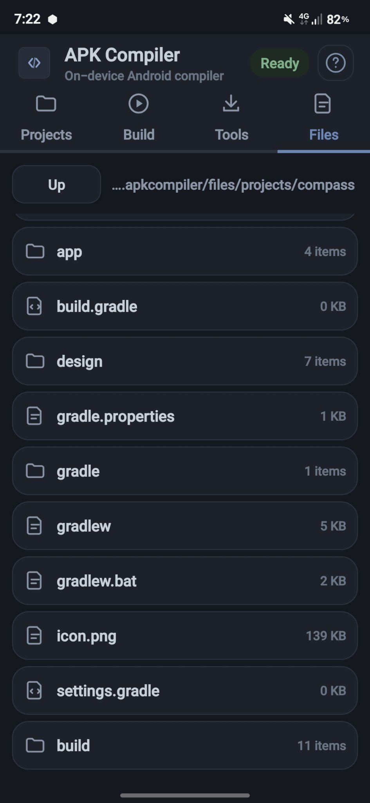
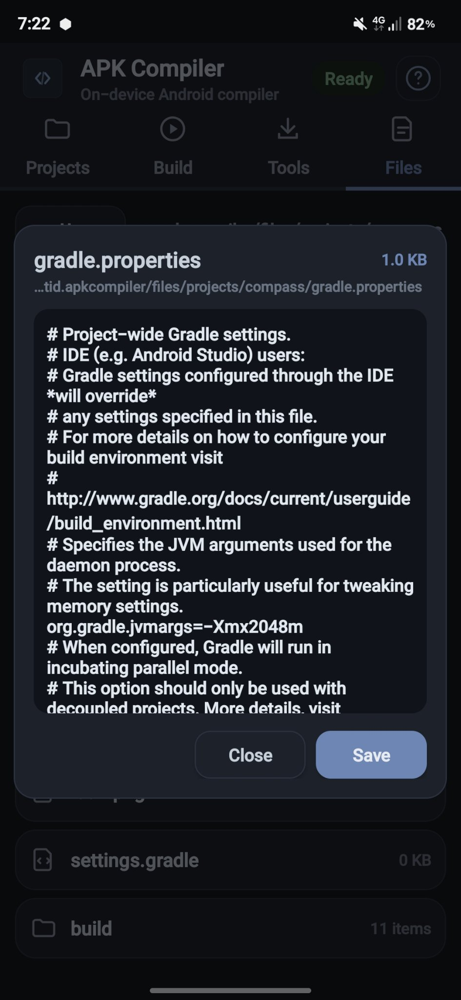
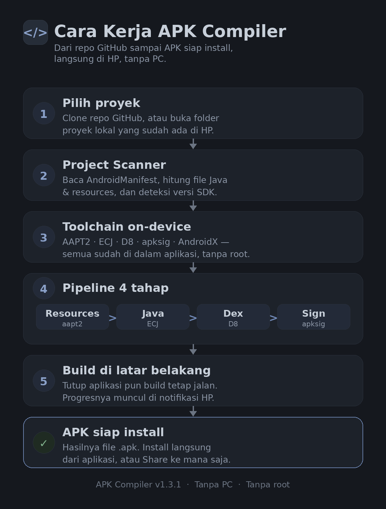

# APK Compiler (Android On-Device Compiler & Git Cloner)

Aplikasi Android native mandiri untuk meng-clone repository proyek Android dari GitHub, memilih direktori lokal, mengelola dependensi build/toolchain (JDK, ECJ, D8, android.jar, AAPT2) langsung dari dalam aplikasi, dan mengompilasi proyek menjadi file APK siap install.

## Preview

<p>
  
  
  
  
  
</p>

## Cara Kerja



1. **Pilih proyek** — Clone repo GitHub, atau buka folder proyek lokal yang sudah ada di HP.
2. **Project Scanner** — Baca `AndroidManifest.xml`, hitung file Java & resources, dan deteksi versi SDK.
3. **Toolchain on-device** — AAPT2, ECJ, D8, apksig, dan AndroidX sudah di dalam aplikasi, tanpa root.
4. **Pipeline 4 tahap** — Resources (aapt2) → Java (ECJ) → Dex (D8) → Sign (apksig).
5. **Build di latar belakang** — Tutup aplikasi pun build tetap jalan; progresnya muncul di notifikasi HP.
6. **APK siap install** — Hasilnya file `.apk`. Install langsung dari aplikasi, atau Share ke mana saja.

## Fitur Utama

1. **GitHub Git Cloner**:
   - Input URL repository GitHub (format `https://github.com/owner/repo` atau branch custom).
   - Mengunduh zipball repositori secara otomatis dengan penanganan HTTP 301/302 redirects.
   - Pengekstrak zip aman dengan perlindungan *Zip Slip*.
   - Auto-detect proyek Android setelah diekstrak.

2. **Project Scanner & Folder Navigator**:
   - Mendeteksi struktur proyek Android (Gradle layout `app/src/main` maupun Eclipse/Flat layout).
   - Parsing otomatis `AndroidManifest.xml` (package name, minSdkVersion, targetSdkVersion).
   - Penghitungan otomatis file sumber Java dan resource assets.
   - Folder picker lokal untuk memilih folder proyek mana saja di penyimpanan perangkat.

3. **In-App Toolchain & Dependency Manager**:
   - Memeriksa kelengkapan dependensi compiler secara real-time.
   - Tombol satu klik: **"Pasang Semua Dependensi"** untuk mengunduh komponen compiler:
     - Eclipse Compiler for Java (`ecj.jar` - JDK bytecode compiler untuk Android Dalvik/ART).
     - Android D8 Dexer (`d8.jar` - konversi .class ke classes.dex).
     - Android SDK Platform (`android.jar` - API definitions).
     - AAPT2 Tool (kompilasi layout, resources, dan link manifest).
     - Android Debug Keystore (kunci kriptografi RSA 2048-bit untuk penandatanganan APK).

4. **Pipeline Kompilasi On-Device**:
   - **Step 1: Resource & Manifest** -> Menghasilkan `R.java` dan base APK zip.
   - **Step 2: Java Compile** -> Mengompilasi source `.java` menjadi `.class`.
   - **Step 3: DEX Compile** -> Mengonversi `.class` menjadi `classes.dex`.
   - **Step 4: Package & ZipAlign** -> Merakit APK dan merapikan 4-byte boundary.
   - **Step 5: Sign APK** -> Menandatangani APK dengan keystore debug.
   - **Step 6: Output & Action** -> Tombol langsung **"Install APK"** (via `FileProvider`) dan **"Bagikan File"**.

5. **Terminal Console & UI (v1.3.1)**:
   - Tema gelap kalem low-contrast: permukaan slate gelap, teks abu lembut (bukan putih), satu aksen biru baja yang diredam. Tanpa gradien, tanpa glow, tanpa emoji. v1.3.0 yang putih terang sudah diganti karena terlalu kontras.
   - Logo baru: mark `</>` satu warna biru baja di atas kotak slate gelap, tanpa kartu putih dan tanpa biru terang.
   - Tab berikon (Projects, Build, Tools, Files) dengan indikator tab aktif.
   - Stepper pipeline visual: Resources, Java, Dex, Sign.
   - Kartu proyek dan komponen toolchain berikon, teks dipangkas ke yang perlu saja. Placement diperbaiki: header tinggi tetap 56dp (subtitle satu baris), kartu proyek/SDK vertikal dengan statistik sejajar di bawah judul, tombol utama tanpa ikon di pinggir (teks rata tengah).
   - Log terminal real-time dengan auto-scroll dan penanda status; baris yang sama persis tidak dicetak dua kali, dan tombol Install all tidak bisa ditekan dua kali bersamaan.
   - **Build latar belakang**: kompilasi jalan lewat foreground service, tetap jalan walau aplikasi ditutup, dengan progress bar di notifikasi. Buka lagi aplikasinya untuk melihat hasil; notifikasi selesai bisa diketuk untuk kembali ke aplikasi.

## Lokasi Artifact APK
- Output build: `ApkCompiler.apk` (Root direktori proyek)
- Ukuran: ~14,9 MB (self-contained: ECJ, D8, apksig, AAPT2 statis, AndroidX essentials)

## Cara Build Ulang
```bash
cd ~/workspace/apk-compiler
./build.sh
```
